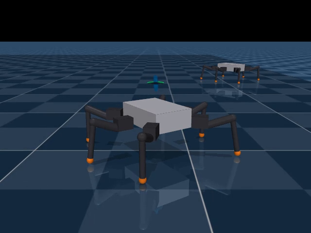

# Hardware

## Components

Chosen so far:

| Part | Choice | Why |
|---|---|---|
| Servos | 19 × Feetech STS3215, 12 V version (C018 or C047): 18 in the legs, 1 in the neck | 30 kg·cm (2.94 N·m) stall torque; report position, speed, load, voltage and temperature over a single bus |
| Servo adapter | 1 or 2 × Waveshare Bus Servo Driver Board, jumpers on **B** (USB) | Connects the Pi to the 1 Mbps half-duplex servo bus over USB |
| Computer | Raspberry Pi 5 | Runs the policy, the servo bus and perception on its CPU; there is no GPU |
| Depth camera | Intel RealSense D435i | Metric depth from about 20 cm, global shutter, built-in IMU; powered over USB 3 |
| Battery | 3S2P Li-ion pack, 18650 cells (Ampace JP30 or equivalent) in a single layer, with a 3S BMS; servos on the battery, a 5 V UBEC for the Pi | Flat (about 20 mm), 65 Wh, about 40 minutes of walking by a conservative estimate; see [Power budget and battery](power.md) |

Still open:

| Part | Requirement | Depends on |
|---|---|---|
| IMU | Mounted rigidly near the center of mass, at 200 Hz or more | Whether the D435i's IMU, mounted with the camera, is close enough to the center of mass |

!!! note "Power"
    How much the servos, the Pi and the camera draw, how the battery is sized and built, and how the servos are protected against overcurrent: [Power budget and battery](power.md).

## Folders

| Folder | Contents |
|---|---|
| `hardware/printed/` | Parts you print: STEP files to edit, STL files to slice |
| `hardware/components/` | Parts you buy: their models, for the assembly and the robot model |
| `hardware/model/` | The robot model used in simulation and training: MJCF now, URDF later |

The model lives with the parts because it changes with them: when a printed part changes, update the model in the same commit.

## Robot model

Until the CAD exists, `hardware/model/h3215.xml` is a provisional model built from primitive shapes:

{ width="560" }

| Property | Value |
|---|---|
| Leg segments | Coxa 68 mm, femur 77 mm, tibia 122 mm (H-0996's proportions) |
| Mass | 2.14 kg: 1.03 kg base (six coxa servos, Pi, servo board, battery, camera) and 185 g per leg |
| Default pose | Femur raised 0.35 rad, tibia −0.25 rad: base at 11.7 cm, feet 22–25 cm from the center |

Frames and numbering:

- **Base frame:** x forward, y left, z up.
- **Legs:** numbered like H-0996, clockwise from above: 1 front-right, 2 middle-right, 3 rear-right, 4 rear-left, 5 middle-left, 6 front-left.
- **Joints:** in each leg frame x points out of the body. A positive femur angle lifts the femur, a positive tibia angle swings the foot outward.

The names of bodies, joints, geoms, sites and sensors are what the training tasks rely on: keep them when the model is replaced by the CAD export.
