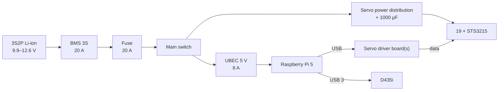

# Power budget and battery

This page estimates how much power H-3215 draws, sizes the battery from that estimate, and defines how the pack is built and how the servos are protected against overcurrent. Every number follows from the assumptions in the tables, so when a part or the robot's mass changes, the estimate can be redone in the same way.

The loads are:

| Load | Rail | Count |
|---|---|---|
| Feetech STS3215, 12 V version (C018 / C047): 18 in the legs, 1 in the neck | Battery, directly | 19 |
| Waveshare Bus Servo Driver Board | Battery (servo power), 5 V from USB (logic) | 1 or 2, depending on the bus latency |
| Raspberry Pi 5 | 5 V | 1 |
| Intel RealSense D435i | 5 V, powered from the Pi's USB 3 port | 1 |
| AI HAT (optional) | 5 V, from the Pi | 0 or 1 |

## Servo current model

The datasheet gives two operating points for the 12 V STS3215:

| Quantity | Symbol | Value |
|---|---|---|
| Stall torque at 12 V | $\tau_s$ | 2.94 N·m (30 kg·cm) |
| Stall current at 12 V | $I_s$ | 2.7 A |
| No-load running current | $I_0$ | 0.18 A |
| Standby current, holding without load | $I_q$ | 0.03 A |

In a DC motor the current grows linearly with the torque it delivers, so between the no-load point and the stall point:

$$
I(\tau) = I_0 + k_\tau \, \tau, \qquad k_\tau = \frac{I_s - I_0}{\tau_s} = \frac{2.7 - 0.18}{2.94} \approx 0.857 \ \mathrm{A/(N \cdot m)}
$$

This is the current through the motor. The servo drives the motor with PWM, and with a duty cycle $D \le 1$ the average current taken from the supply is at most the motor current:

$$
I_\text{supply} = D \, I_\text{motor} \le I_\text{motor}
$$

Using $I(\tau)$ as the supply current therefore overestimates it, most of all when a joint holds torque at low speed. The estimate below is a **conservative bound**: the real consumption should be lower, and measurements will replace it (see [Validating the estimate](#validating-the-estimate)). For a servo that holds a position rather than moving, $I_q$ replaces $I_0$.

The current depends on the torque, not on the supply voltage, so the model holds across the battery's voltage range.

## Joint torques

The torque a joint must deliver to carry the body is the vertical force on the foot times the horizontal distance from the joint axis to the foot:

$$
\tau_j = F_z \, d_j, \qquad F_z = \frac{m g}{n}
$$

where $m$ is the robot's mass and $n$ the number of feet on the ground. From the default pose (femur raised 0.35 rad, tibia 0.10 rad past vertical):

$$
d_\text{femur} = l_f \cos\theta_f + l_t \sin\theta_t = 77 \cos(0.35) + 112 \sin(0.10) \approx 83.5 \ \mathrm{mm}
$$

$$
d_\text{tibia} = l_t \sin\theta_t = 112 \sin(0.10) \approx 11.2 \ \mathrm{mm}
$$

with $l_t$ the distance from the tibia joint to the foot. The coxa joint's axis is vertical, so the body's weight puts no torque on it; it carries the horizontal forces that push the body forward and turn it.

The femur carries almost all the load: its lever arm is seven times the tibia's.

The neck servo carries the camera's mount, not the body. Its torque is assumed: 0.1 N·m holding the head, 0.2 N·m at peaks.

## Operating scenarios

The scenarios use $m = 2.14$ kg, the mass of the provisional robot model.

### Standing

All six feet on the ground ($n = 6$) and the joints holding still:

| Joint | Torque | Current per servo |
|---|---|---|
| Femur | $3.50 \ \mathrm{N} \times 83.5 \ \mathrm{mm} = 0.29$ N·m | 0.28 A |
| Tibia | $3.50 \ \mathrm{N} \times 11.2 \ \mathrm{mm} = 0.04$ N·m | 0.06 A |
| Coxa | ≈ 0 | 0.03 A |
| Neck | 0.10 N·m (assumed) | 0.12 A |

That is 0.37 A per leg and **2.36 A in total**.

### Walking

In a tripod gait three legs carry the body ($n = 3$) while the other three swing forward. Each leg spends half the cycle in each phase (duty factor $\delta = 0.5$), so at any instant the total current is

$$
\bar{I}_\text{servos} = 3 \, I_\text{stance} + 3 \, I_\text{swing} + I_\text{neck}
$$

All joints move, so $I_0$ is the base current. The coxa torque in stance and the joint torques in swing are not set by the weight; they are assumed:

| Phase | Joint | Torque | Current per servo |
|---|---|---|---|
| Stance | Femur | $7.0 \ \mathrm{N} \times 83.5 \ \mathrm{mm} = 0.58$ N·m | 0.68 A |
| Stance | Tibia | $7.0 \ \mathrm{N} \times 11.2 \ \mathrm{mm} = 0.08$ N·m | 0.25 A |
| Stance | Coxa | 0.15 N·m (assumed, propulsion) | 0.31 A |
| Swing | Each joint | 0.10 N·m (assumed, leg of 185 g) | 0.27 A |
| — | Neck | 0.10 N·m (assumed) | 0.27 A |

A stance leg draws 1.24 A and a swing leg 0.80 A: **6.37 A in total**.

### Peak while walking

Touchdown impacts, the body's accelerations and an uneven distribution of weight among the stance legs raise the forces above their static value. A dynamic factor $k_d = 2$ on the stance torques, and 0.2 N·m on the swing joints and the neck, give **9.31 A**. These peaks last tens of milliseconds and are what the battery must supply without its voltage dropping.

### All servos stalled

The theoretical worst case, every servo at its stall current at once:

$$
I_\text{max} = 19 \, I_s = 51.3 \ \mathrm{A}
$$

It does not happen in operation: the servos' own protection (see [Overcurrent protection](#overcurrent-protection)) removes the torque long before. Two cases come close for a few milliseconds:

- **Power-on:** when all servos enable their torque at once and jump to a target, each one draws close to its stall current until it gets there. Enable the torque with a low `Torque_Limit` and ramp it up, or enable one leg at a time, so the BMS does not trip.
- **A short circuit**, which the fuse must open.

## Electronics

| Load | Power | Note |
|---|---|---|
| Raspberry Pi 5 | 8 W | About 3 W idle, about 7 W with all four cores loaded |
| RealSense D435i | 3 W | Intel advises budgeting 2 W per camera; retailers list about 2.5 W |
| Servo driver boards | 1 W | USB-to-serial converter and bus transceiver, 0.5 W per board, two boards |
| **Total on 5 V** | **12 W** | 2.4 A at 5 V |
| AI HAT (optional) | +3 W (assumed) | 15 W in total, 3.0 A at 5 V |

## Power from the battery

The servos run from the battery directly; the 5 V rail goes through a switching regulator with efficiency $\eta_5 = 0.90$. The power drawn from the battery is

$$
P_\text{bat} = V_\text{bat} \, I_\text{servos} + \frac{P_5}{\eta_5}, \qquad I_\text{bat} = I_\text{servos} + \frac{P_5}{\eta_5 \, V_\text{bat}}
$$

| Scenario | Servos | 5 V rail | Battery power | Battery current |
|---|---|---|---|---|
| Standing | 25.5 W | 13.3 W | 39 W (42 W with the HAT) | 3.6 A |
| Walking | 68.8 W | 13.3 W | 82 W (86 W with the HAT) | 7.6 A |
| Peak while walking | 92.2 W | 13.3 W | 106 W | 10.7 A at 9.9 V |

Standing and walking are computed at the nominal 10.8 V. The peak is computed at the lowest voltage the battery reaches under load, where the current is highest.

## Battery

### Voltage: 3S, servos on the battery

The servos are rated for 12 V and the servo board accepts 9–12.6 V. A three-cell lithium pack (3S) fits that window without a regulator:

| State | Per cell | 3S pack |
|---|---|---|
| Full | 4.20 V | 12.6 V |
| Nominal | 3.60 V | 10.8 V |
| Robot stops (software cutoff, under load) | 3.30 V | 9.9 V |
| BMS cutoff (last resort) | 2.5–2.8 V | 7.5–8.4 V |

A 4S pack (16.8 V full) is above the servos' rating at every state of charge and would need a buck converter regulating 12 V at 15 A or more: a heavy part that wastes about 10% of the servos' power as heat. **The robot uses a 3S pack with the servos on the battery directly**, and only the 5 V rail is regulated.

The cost is that the servos' voltage follows the battery. Their torque and speed scale with it, so the stall torque goes from

$$
\tau_s(V) = \tau_s \, \frac{V}{12 \ \mathrm{V}}: \qquad 3.09 \ \mathrm{N \cdot m} \text{ at } 12.6 \ \mathrm{V}, \qquad 2.43 \ \mathrm{N \cdot m} \text{ at } 9.9 \ \mathrm{V}
$$

The walking peak on a femur is 1.17 N·m, 48% of the stall torque of an empty battery, so the robot keeps its margin at every charge. What changes is how fast the servos respond, which the policy must tolerate:

- **In training:** randomize the servos' strength (torque limit and gain) between about 0.8 and 1.05 times the nominal values.
- **Optionally:** give the policy the battery voltage as an observation.

### Format: 18650 cells, flat 3S2P

The battery has little room in height, so the pack must be flat. The options compared:

| Option | Height | Energy | Mass | Verdict |
|---|---|---|---|---|
| **3S2P 18650 Li-ion, one layer** | **≈ 20 mm** | **65 Wh** | **≈ 310 g** | **Chosen:** the flattest pack with the most energy |
| 3S1P 21700 Li-ion | ≈ 23 mm | 49–54 Wh | ≈ 230 g | Smaller in volume, but 3 mm taller |
| 3S LiPo 5000 mAh | ≈ 25 mm | 55 Wh | ≈ 370 g | Thicker, longer and heavier |
| 9 × AA Ni-MH, 2000 mAh | ≈ 15 mm | 22 Wh | ≈ 245 g | A third of the energy; 9 cells start above 12.6 V and sag under 10 A |

The six cells lie side by side in a single layer, in one of two layouts:

| Layout | Footprint (approx., wrapped) |
|---|---|
| One row of six | 115 × 68 × 20 mm |
| Two rows of three, end to end | 57 × 134 × 20 mm |

### Cell

| Cell | Capacity | Continuous current | Note |
|---|---|---|---|
| **Ampace JP30** | 3000 mAh | 36 A (30 A in a later Ampace rating) | First choice: genuine, high-drain, sold by EU battery shops such as NKON |
| Molicel P30B | 3000 mAh | 36 A | Equivalent; harder to find |
| Molicel P28A | 2800 mAh | 35 A | Equivalent, slightly less capacity |
| EVE 30P | 3000 mAh | 20–30 A | Alternative if the others are not available |

Higher-capacity cells (3500 mAh, 8–10 A) would give about 20% more runtime, but they sag about three times more on peaks, and the servos see that sag directly.

Buy flat-top, unprotected cells, all six of the same model and batch. Counterfeits are common on marketplaces (AliExpress, Amazon third-party sellers): a battery shop is the safer source. Whatever the source, check each cell before building the pack:

1. **Mass:** about 45–48 g. Fakes are often lighter.
2. **Capacity:** a discharge test on a hobby charger, about 2900–3000 mAh for a 3000 mAh cell.
3. **Internal resistance:** the six cells should be close to each other; reject outliers.

### Capacity and runtime

The pack's energy is

$$
E = 3 \times 3.6 \ \mathrm{V} \times 2 \times 3.0 \ \mathrm{Ah} = 64.8 \ \mathrm{Wh}
$$

Stopping at 3.3 V per cell under load leaves about 85% of it usable, so the runtime at a constant power is

$$
t = \frac{\mathrm{DoD} \, E}{P_\text{bat}} = \frac{0.85 \times 64.8 \ \mathrm{Wh}}{P_\text{bat}}
$$

| Scenario | Battery power | Runtime | With the AI HAT |
|---|---|---|---|
| Walking | 82 W | 40 min | 38 min |
| Standing | 39 W | 85 min | 78 min |

Since the servo estimate is a bound, the real runtime should be longer.

### Discharge rate and sag

The peak of 10.7 A is 1.8 times the pack's 6 Ah capacity, and 5.3 A per cell: a small fraction of the cells' 30–36 A. With about 15 mΩ per cell (assumed), the pack's resistance is

$$
R_\text{pack} = \frac{3 \times 15 \ \mathrm{m\Omega}}{2} + R_\text{BMS} + R_\text{wires} \approx 35 \ \mathrm{m\Omega}
$$

and the voltage sags by about $10.7 \ \mathrm{A} \times 35 \ \mathrm{m\Omega} \approx 0.4$ V on a peak.

### Mass

Six cells at about 47 g, plus nickel, wrap, BMS and leads, weigh about 310 g. The provisional model counts the battery in its 1.03 kg base, and its mass sets the torques above: once the pack is built, update the model's base mass and redo the estimate with the new $m$. Each joint torque scales with $m$, so the servo currents grow by $k_\tau$ times the added torque, and the runtime shrinks a little.

## Building the pack

### Wiring

The two cells of each pair are joined in parallel by the nickel strip, and the pair behaves as one cell of 6000 mAh. The three pairs are in series, and the BMS sees three cells:

```
            Group 1          Group 2          Group 3
           (2 × 18650)      (2 × 18650)      (2 × 18650)
  B− ──── [−   ‖   +] ──┬── [−   ‖   +] ──┬── [−   ‖   +] ──── B+
                        │                 │
                        B1                B2
```

| BMS input | Connects to |
|---|---|
| B− | Negative of group 1, and the BMS's main negative |
| B1 | Between group 1 and group 2 |
| B2 | Between group 2 and group 3 |
| B+ | Positive of group 3, which is also the pack's positive |

A 4-pin JST-XH balance lead taps the same four points, so a hobby charger can balance the pack and read each group's voltage. Connect the BMS's inputs in the order its instructions give, usually B− first and then B1, B2 and B+.

The cells of a pair are always at the same voltage, because they are connected directly: they need no balancing between them. The BMS balances the three groups against each other.

### Rules

- **Matched cells:** same model and batch, new. Pair the cells whose capacity and internal resistance are closest.
- **Same voltage before joining:** charge all six cells to within about 0.05 V of each other. Otherwise the fuller cell discharges into the emptier one, with tens of amperes, as soon as they are welded.
- **Spot-welded pure nickel strip,** 0.15–0.2 mm. No soldering on the cells: the heat damages them. Without a spot welder, a battery shop can assemble the pack.
- **Insulation:** fish-paper rings on the positive ends, then shrink wrap around the pack.
- **Main leads:** 16 AWG silicone wire, 14–16 AWG on the BMS's P− terminal, with an XT60 or XT30 connector.
- **BMS** at one of the pack's short ends, so the pack stays flat.

### BMS

| Requirement | Value | Why |
|---|---|---|
| Cells | 3S | One input per group |
| Continuous current | ≥ 20 A | Above the 10.7 A peak, with margin for an optimistic rating |
| Overcurrent trip | Above the power-on current, or with a delay of tens of milliseconds | So the servos enabling their torque does not cut the power |
| Short-circuit protection | Yes | Backs up the fuse |
| Balancing | Optional | A hobby balance charger balances the pack through the balance lead |
| Over-discharge cutoff | 2.5–2.8 V per cell | A last resort only: the software stops the robot first |

The BMS chosen for now is a 3S board rated 20 A. Its trip current and delay, and whether it balances, are still to be confirmed from its datasheet. A board that gets warm while the robot walks is rated optimistically.

When the BMS cuts the power, the robot collapses and the Pi loses power without shutting down, which can corrupt its storage. That is why the software cutoff must act first (see [Battery monitoring](#battery-monitoring)).

### Charging

Charge with a hobby balance charger on the balance lead and the main connector, in Li-ion mode (4.20 V per cell), at up to 3 A (0.5 C).

## Power architecture



| Part | Rating | Why |
|---|---|---|
| 5 V regulator | UBEC, 5 V, 8 A (12 A peak), input range covering 9–12.6 V | 3.0 A at most with the AI HAT; the Pi 5 gives its USB ports 1.6 A only from a 5 A supply, and the D435i needs up to about 0.7 A of it. If adjustable, set it to 5.1–5.2 V |
| Fuse | 20 A, at the pack | Above the 10.7 A peak, below the 51.3 A of a stalled robot or a short circuit |
| Main switch | 20 A | Cuts everything; a separate switch or relay on the servo line can cut only the servos |
| Bulk capacitor | 470–1000 µF, low ESR, ≥ 25 V | At the servo distribution point, to absorb current steps |
| Connector | XT60 or XT30 | Rated well above the peak |

The UBEC keeps the servos' current steps away from the Pi: a servo peak sags the battery by about 0.4 V, and the UBEC regulates it away. All rails share the battery's ground.

!!! warning "Servo current through the driver board"
    The board's power input and traces carry every servo's current when the servos are powered through it, up to 10.7 A on peaks. Check their rating. If it is lower, feed each leg's servo chain from a separate distribution point, and take only the data line and ground from the driver board. Splitting the servos between two boards also halves the current through each one.

!!! note "Raspberry Pi 5 on a regulator"
    A regulator cannot negotiate USB Power Delivery, so the Pi assumes a 3 A supply and limits its USB ports to 600 mA. Tell it the supply delivers 5 A: set `PSU_MAX_CURRENT=5000` with `sudo rpi-eeprom-config --edit`. Use short, thick wires from the UBEC to the Pi.

## Battery monitoring

With the servos on the battery, every servo measures the battery's voltage in `Present_Voltage` (address 62, in 0.1 V steps), and the control loop already reads it. This is the battery monitor:

1. **Below 9.9 V under load** (3.3 V per cell), the robot sits down and the Pi shuts down cleanly.
2. **The BMS** cuts the power at 2.5–2.8 V per cell only if the software fails.

The servos' own low-voltage protection (`Min_Voltage_Limit`, and the voltage bit of `Unloading_Condition`) removes their torque and drops the robot: keep it below the software cutoff, or off.

The battery's current can be measured with a shunt monitor such as the INA226 over I²C. It is optional, useful to validate the estimate.

## Overcurrent protection

### A stalled servo

A servo stalls when its load exceeds the torque it can deliver, and it then draws its stall current:

$$
P_\text{stall} = V I_s = 12 \ \mathrm{V} \times 2.7 \ \mathrm{A} \approx 32 \ \mathrm{W}
$$

That much heat in a 55 g case raises its temperature within seconds, and holding it damages the motor and the electronics. A brief stall does not: the servos reach their torque limit in normal operation, on a touchdown or when a position error exceeds a degree or two. What damages a servo is the energy over time,

$$
E = \int_0^{t} I^2(t') \, R \, \mathrm{d}t'
$$

so the protection must act on current **and** time: trip on a current held above a threshold for longer than an interval, not on a single sample.

### Why a cutoff on the battery side does not work

A cutoff at the battery (the BMS, or a fuse) measures the sum of the 19 servos' currents, and that sum cannot tell one stalled servo from a normal peak. While walking, a femur that stalls adds

$$
\Delta I = I_s - I_\text{femur} = 2.7 - 0.68 \approx 2.0 \ \mathrm{A}
$$

to the total, which becomes $\bar{I} + \Delta I \approx 6.4 + 2.0 = 8.4$ A: less than the 9.3 A of a normal peak. A threshold below 9.3 A cuts the power during normal walking; one above it misses a stalled servo. Cutting the power also drops the robot on the ground, which is a hazard of its own.

### Protection in the servos

The STS3215 protects itself. Each servo measures its own current and temperature, and when a limit is exceeded for longer than a set time, it reduces or removes its torque. The registers that configure it:

| Register | Address | Function |
|---|---|---|
| `Protection_Current` | 28 | Current threshold, in 6.5 mA steps |
| `Over_Current_Protection_Time` | 38 | How long the current may stay above the threshold, in 10 ms steps |
| `Overload_Torque` | 36 | Output above which the servo counts as overloaded, in % of the maximum |
| `Protection_Time` | 35 | How long the overload may last before protection, in 10 ms steps |
| `Protective_Torque` | 34 | Torque left once the protection trips, in % |
| `Max_Temperature_Limit` | 13 | Temperature above which the servo removes its torque |
| `Unloading_Condition` | 19 | Which conditions (voltage, temperature, current, overload) remove the torque |
| `Present_Current` | 69 | The current it measures, read-only, in 6.5 mA steps |

This gives every servo its own protection, set for its own joint, and a stalled femur relaxes while the other servos keep the robot standing.

The protection is layered:

1. **In each servo:** the registers above, set when the servos are configured, alongside their IDs and reply delay.
2. **In software:** the control loop already reads each servo's load and temperature; it stops the robot or lowers the gains when a servo stays near its limit or heats up.
3. **In the BMS:** its overcurrent and short-circuit protection, against a fault in the wiring.
4. **At the pack:** the fuse, against a short circuit.

## Validating the estimate

The servo estimate rests on two assumptions that measurements should replace:

- **The current model:** the bound $I_\text{supply} \le I_\text{motor}$ overestimates the consumption at low speed. A shunt monitor measures the battery's current while the robot stands and walks, and each servo's `Present_Current` splits it by joint.
- **The torques:** the coxa, swing and neck torques and the dynamic factor are assumptions. The simulation can log the joint torques of the trained policy while it walks, and give their averages and peaks directly.

With measured numbers, the runtime can be checked against the 40-minute estimate, and the pack's mass put into the robot model.
